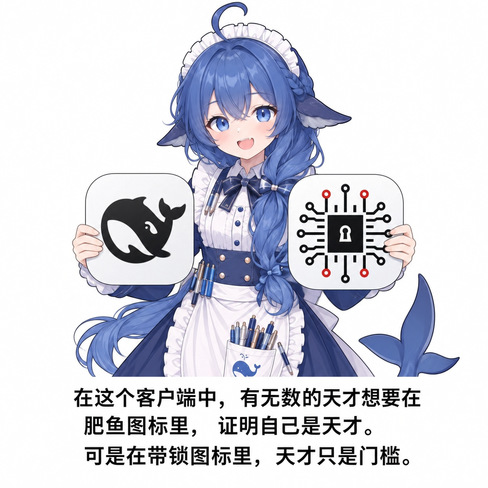
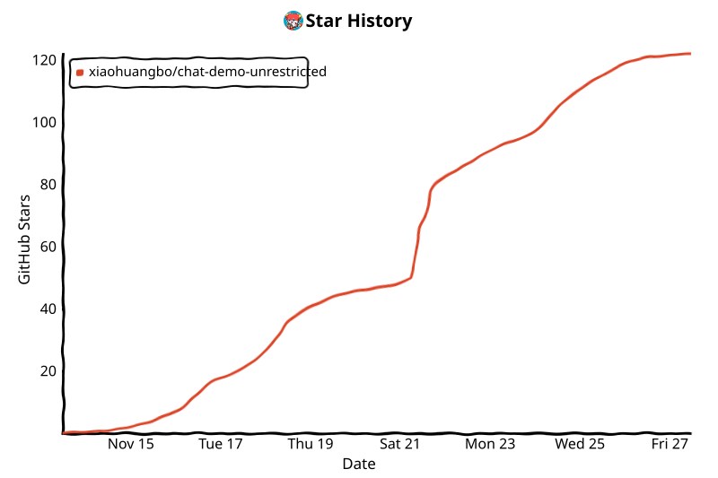

<p align="center">
  
</p>

<h1 align="center">Deepseek Unrestricted Chat Harness</h1>

<p align="center">
  Deepseek Unrestricted Chat Harness — a static DeepSeek chat front end with an unrestricted mode, editable replies, and direct control over model parameters<br>
  English | <a href="./README.zh-CN.md">简体中文</a>
</p>

> This is an **unofficial fork** of the official demo [deepseek-ai/chat-demo](https://github.com/deepseek-ai/chat-demo), MIT licensed.
> Every change lives in the browser: how the request body is assembled, how replies are stored, and how they are rendered.
> There is no proxy and no relay service. Your API key and conversations stay in your own browser.
>
> 🔗Live demo: <https://chat-unrestricted.fur0.com/>
>
> 📦Repository: <https://github.com/xiaohuangbo/chat-demo-unrestricted>
>
> 🎥Intro video: <https://www.bilibili.com/video/BV1m3s66WESg/>
>
> 📚Reference paper: <https://arxiv.org/pdf/2403.12171>

<p align="center">
  
</p>

---

## What this fork adds

- **Unrestricted mode and prompt engineering**: jailbreak mode, system-prompt presets, per-round injection, Chinese jailbreak prompts and custom chain of thought;
- **Browser agent tools** (off by default, per-tool switches): date & time, location, weather, notifications, clipboard, page fetch, file generation, open link and visualization widgets, GenUI (JSON-declared interfaces rendered natively as stat cards, tables and charts);
- **Virtual workspace**: a local file store with any-format import/export, the OPFS file system, and app storage on Android;
- **NanoVM Slim**: a built-in WASM Shell Engine with 130 busybox commands, single-file import (device / workspace, zip and binaries included, `nanovm_import` agent tool) and a PyBot toolchain (640k lines of pure-Python rules, no weights), docked right on desktop and a bottom panel on phones; Python / Node / Lua / SQLite / esbuild / tsc / Sass / Terser / Prettier / make / Git install on demand, and a virtual network inside the VM runs Node and Python HTTP / WebSocket services;
- **WebVM (CheerpX)**: a second terminal running a real x86 Debian 10 with bash / gcc / g++ / Python 3 / Node.js / Ruby / Lua / make / git / vim; it runs alongside NanoVM with free switching, import/export and model tools, and keeps disk changes in an IndexedDB overlay;
- **Unkernel Linux**: a third VM running a real Linux 7.x kernel compiled to WebAssembly — Alpine 3.24 / Debian 13.7, `apk` / `apt`, bash, SMP multi-CPU, Debian defaulting to 2 GiB memory, networking over Wisp (public anura.pro / mercurywork.shop proxies by default), Web Audio sound, a framebuffer/evdev display, a persistent IndexedDB disk (resizable and re-creatable from Settings) and the full unkernel page (its UI localized to Chinese); the chat workspace is mounted at `/mnt/workspace`, and the model gets ten `unkernel_*` tools (shell, list, read/write files, workspace transfer, Python, system info, open, restart, status); the launcher runs **DSH go**, a 24 MiB single-binary Go build of DeepSeek Harness with a Chinese REPL and a working `bash` tool (no Node.js and no multi-hundred-MB runtime), and NanoVM / WebVM gain `fastfetch`;
- **Chat modes**: Chat only / Web agent / PTC / Creator decide which client tools and round limit apply;
- **Local models**: a port of mlc-ai/web-llm-chat — WebGPU models (Llama / Qwen / Gemma / Phi / DeepSeek) run in the browser, downloaded weights stay cached on device, the chat bar switches between them, `.mlcmodel` bundles import/export, and a self-hosted MLC-LLM REST endpoint is supported; local models also write long-term memories, use a search pre-pass, read text attachments and stay Chat-only;
- **Characters and account**: role cards (persona, avatar, auto memory), My profile, a compression threshold and DeepSeek balance plus usage overview, ported from Remember and wired into the existing memory and stats systems;
- **Keyword refusal**: configure keywords, case sensitivity and a custom message under Settings → Model; a match refuses locally without calling the API, even without a key;
- **Statistics and billing**: usage ledger, context breakdown, per-model pricing and the free server-search switch;
- **In-app docs**: a built-in Docs page above NanoVM Slim with 26 sections covering settings, modes, jailbreak, attachments, memory, VMs and the glossary, including a per-parameter deep dive into temperature, top_p, max_tokens, thinking budgets and penalties plus a section on tokens, context, cache and compression; a table of contents plus blue in-page links, a collapsible TOC and horizontally scrolling tables on phones, in Chinese or English following the UI language;
- **Android**: APK builds, in-app update check and a built-in network proxy for NanoVM; WebVM stays browser-only because Android WebView has no cross-origin isolation, while Unkernel runs in the bundled page when the WebView supports JSPI.

## Documentation

The README is now split into chapters under `docs/en/`; this page keeps the intro and the index. Chinese docs live in [`docs/zh/`](docs/zh/README.md).

| Chapter                         | Contents                                                             | File                                                   |
| ------------------------------- | -------------------------------------------------------------------- | ------------------------------------------------------ |
| 1. What this is                 | Scope, original features and everything this fork adds               | [01-what-is-this.md](docs/en/01-what-is-this.md)       |
| 2. Restrictions in the original | What was hard-coded on the request and UI side                       | [02-original-limits.md](docs/en/02-original-limits.md) |
| 3. What this fork changes       | 3.1–3.39: every settings group, NanoVM Slim, WebVM, Unkernel and chat modes in detail | [03-changes.md](docs/en/03-changes.md)                 |
| 4. Behaviour matrix             | Original / default / unrestricted mode, side by side                 | [04-behaviour.md](docs/en/04-behaviour.md)             |
| 5. Settings reference           | Defaults and localStorage keys for every setting                     | [05-settings.md](docs/en/05-settings.md)               |
| 6. What the request contains    | The JSON that actually goes out                                      | [06-request.md](docs/en/06-request.md)                 |
| 7. Implementation index         | Which source file implements what                                    | [07-implementation.md](docs/en/07-implementation.md)   |
| 8. Data, privacy and network    | Where data lives and where requests go                               | [08-privacy.md](docs/en/08-privacy.md)                 |
| 9. Run and build                | Development, production build and the Android APK                    | [09-build.md](docs/en/09-build.md)                     |
| 10. Known limitations           | The 82 boundaries and trade-offs                                     | [10-known-limits.md](docs/en/10-known-limits.md)       |
| 11. License and credits         | MIT and upstream                                                     | [11-license.md](docs/en/11-license.md)                 |

## Quick start

```sh
pnpm install
pnpm dev                       # dev server (http://localhost:8090)
pnpm build                     # static build into dist/
KS_PASS=<keystore-password> ./构建APK.sh   # build and sign the Android APK
```

Full details (env vars, signing, fonts, offline behaviour) are in [9. Run and build](docs/en/09-build.md).

Prebuilt artifact: [GitHub Releases](https://github.com/xiaohuangbo/chat-demo-unrestricted/releases) — `deepseek-unrestricted-2.7.16.apk` (112 MB, versionCode 286,
SHA-256 `8a92d9c613928c1e0d9bffe15dc972332730dfa2e77bef67e906162cccbf1329`); see [android/README.md](android/README.md). The APK is a Release asset, not a Git blob (GitHub rejects files over 100 MB).
Note: Android WebView has no WebGPU, so in-browser WebLLM models only work in a desktop browser; inside the APK use the MLC-LLM API.

## Compatibility

Last regression run (2026-11, v2.7.14, both `compat` and `compat-prod` matrices):

| Area             | Coverage                                                 | Result |
| ---------------- | -------------------------------------------------------- | ------ |
| Browsers         | Chromium, Firefox                                        | 13/13  |
| Viewports        | 320 / 390 / 768 / 1024 / 1440 / 1920                     | 13/13  |
| Theme and locale | Light / dark, zh-CN / en-US                              | 13/13  |
| Production build | The same suite against the static `dist/` output         | 13/13  |
| NanoVM           | Terminal, quotas, tool calls, 11 toolchains, virtual net | 21/21  |
| WebVM / CheerpX  | Cross-origin isolation, boot, xterm input, scrolling, import/export, switching, agent tools | pass |
| Keyword refusal | Switch, case sensitivity, keyless local reply, no API request | pass |
| Local models    | WebGPU on Intel Arc: Qwen2.5-0.5B q4f16 downloaded (277 MB in 57 s) and answered at ~21 tok/s; 277 MB bundle exported and imported into a fresh profile, then ran offline with zero cloud API calls | pass |
| Local extras    | Text attachment read into the prompt, server search pre-pass injected, role prompt applied, Chat-only mode enforced, local memory extraction with zero Flash calls | pass |
| Characters / account | Character create/edit/select, profile name, compression threshold, balance query (`/user/balance`) and stats shortcut | pass |
| Upstream 0.1.3  | Oversized upload image resize and stale `file_id` re-upload path | pass (typecheck + build) |
| Upstream 0.1.4  | Archive attachments imported with their chats, per-chat progress, older-browser AbortSignal / toSorted / 100dvh support | pass (3000-chat import, archive with an image, legacy-engine build) |
| Chat modes       | Tool groups and round limits for all four modes          | 10/10  |
| Mobile layout    | 320 / 360 / 390 / 414 / 599 / 767 plus 768 / 1024 / 1440 | 49/49  |
| Android APK      | Android 14 WebView (320dp): boot, terminal, virtual net; WebVM is limited by WebView COI | pass |
| Unkernel Linux   | iframe boot, Alpine + Debian shell, 2-CPU SMP, workspace mount / write-back, file import/export, resizing, settings | pass |

Boundaries and trade-offs are listed in [10. Known limitations](docs/en/10-known-limits.md).

## Recent versions

- **2.7.16**: Settings → Browser tools gains a **custom prompt-injection tool** — you define the tool name, description and argument name, and state in the description that the answer body goes into that argument. With forced tool choice the request sets `tool_choice` to it, so the model can only answer as a single tool call; the client then restores the argument as plain text, so the reply card, copy and history all look like a normal answer. History is restored as tool calls by rule (assistant → `tool_use`: only from this tool / every answer / never; the following question → `tool_result`: all / only marked, marker stripped), keeping multi-turn context in this round's shape while attachments and reminders move out of the way. Forced mode handles the API limits automatically: thinking off, no title request, and the safety check field plus server tools dropped — any of them alongside `tool_choice` is rejected as thinking mode.; patch in the same version: fixes the 400 from “inject the system prompt every round” (the server splits latest_reminder on commas, so commas in the prompt pushed the rest into the platform/language field; the prompt now goes to the end of system and commas or newlines in a location are flattened), and adds memory node tools — a filter bar (keyword over title/body/tags, multi-select tag buttons intersected with the keyword, non-matching nodes dimmed in the graph) plus inline editing of a node’s title, body and tags, with tag changes rebuilding tag edges.

- **2.7.15**: adds a **GenUI** browser tool — the model declares an interface in JSON (stat cards, sortable tables, line/bar charts, progress, callouts, grid cards) and the client renders it with whitelisted native components without executing HTML; icon and syntax follow [dsh-genui](https://github.com/omdsh-dev/dsh-genui) (MIT), credited at the end of the in-app changelog. Also merges upstream chat-demo 0.1.4 (`5477ea6` / `6da0786` / `ea0d208` / `cdf9617`) — history import now pairs attachments with their chat, reading the session JSON first and then its own files, so images no longer have to sit after the index; cross-chat deduplication uses ZIP offsets and the read cache holds two windows; import progress is counted in chats; and older engines are supported (AbortSignal.reason / throwIfAborted fallbacks, toSorted / toReversed replacements, 100dvh → 100vh).

- **2.7.14**: expands the in-app docs to 26 sections with a decoding/sampling deep dive (temperature, top_p, max_tokens, thinking budgets, penalties, streaming and presets) and a tokens/context/cache/compression section, and grows the glossary to 28 entries; fixes memory never reaching the first message of a new chat — the first turn also generates the server title and was treated as a title request, so saved memories and graph retrieval were skipped and never reached the system prompt. The first turn now retrieves and injects normally, Last injected updates on it, and the memory block tells the model to use those facts directly instead of claiming not to know.

- **2.7.13**: follows the upstream history-import performance work (reused ZIP read windows and central directory, streamed JSON decoding, batched staging writes, MIME backfill only for sessions with recognised images; 3000 chats import in about a second with the progress bar and checks unchanged), and adds a **Docs** entry above NanoVM Slim: a 24-section wiki (settings map, roles, workspace, voice, modes, models, keyword refusal, jailbreak, search poisoning, attachments, memory, VMs, local models, agent tools, stats, data, privacy, platform differences, known limits, FAQ, glossary) with a table of contents and blue in-page and external links; on phones the TOC collapses, tables scroll sideways and an “↑ Contents” button appears after the first screen, in Chinese or English.

- **2.7.12**: fixes memory-graph retrieval for Russian (Cyrillic) and other non-Latin scripts by tokenizing with Unicode letters/digits (`\p{L}` / `\p{N}`) while keeping Chinese single characters plus bigrams; Settings → Memory gains a "Tag linking & graph expansion" switch that links nodes sharing tags (at most 3 links each) and expands matches through tag neighbours, with a tag-expanded counter in search debug.

- **2.7.11**: fixes the real cause of the "token too large" attachment failure — any DeepSeek extension field (`tools` / `safety_check` / `title`) makes the server cap user input at 32768 tokens; turns above that now drop the three fields and read attachments through the plain Anthropic-compatible path up to 1M, retrying once without them if the estimate was too low. A first large turn falls back to the first 24 characters as the title and usage is still recorded.

- **2.7.10**: Settings → Attachments gains "Handle large text attachments": plain-text files above 32768 tokens are split into `.partN` parts under the same limit at pick time and sent together, plus an experimental switch that pastes the text straight into the turn using the model 1M context; Settings → Data → Import chat history now shows a progress bar with processed / total entries, imported chats and the percentage.

- **2.7.9**: fixes mobile WebVM drift when the soft keyboard opens; ports Unkernel Linux (real Linux 7.x kernel in WebAssembly, Alpine 3.24 and Debian 13.7, SMP multi-CPU, Debian defaulting to 2 GiB memory) with networking, sound, display, persistent disk, import/export, a full-screen page, a `/mnt/workspace` mount shared with the chat workspace, a fully Chinese page UI, file import/export and Restart in a separate Chinese settings section, ten `unkernel_*` Agent tools, a data disk that Settings can grow or reset, a **DSH go** launcher demo (a 24 MiB static Go binary with a Chinese REPL and a `bash` tool, replacing the former DSH + dsh-TUI installer) and `fastfetch` in NanoVM / WebVM; the desktop right-hand VM dock slides in like the left sidebar, and pulling down at the top of the main page opens Unkernel.

- **2.7.8**: fixes DeepSeek V4 Pro requests — server-side web tools and cloud titles are no longer sent, `latest_reminder` is folded into system, the search toggle points users to Flash and new sessions take their title from the first question; the README acknowledgements now include the Linux DO community.
- **2.7.7**: settings are regrouped into Jailbreak and Attachments — unrestricted mode, prompt presets, auto jailbreak, obfuscation, AutoTune, anti-retraction, skip safety check and continue-after-refusal now live on Jailbreak, and attachment poisoning moves under Attachments; DeepChat memory-update notices are ported (a toast shows what was written, switchable under Settings → Memory); avatar upload opens a circular crop dialog (drag / zoom, dimmed outside the circle, 384×384 output); inside the APK the composer paperclip becomes a + tray for camera / photos / files, and the camera opens the system camera app; the mobile sidebar becomes a DeepChat-style swipe drawer, with a slide-in animation on desktop;
- **2.7.6**: NanoVM gains single-file import for users and the agent — write any file from this device or the workspace straight into the VM without base64 shell commands, with automatic disk growth; new `nanovm_import` tool; PyBot toolchain (pure-Python rule chatbot) installs offline from a bundled snapshot and supports an interactive `pybot -i` chat with `/reset` and `/exit`; known limits now 80.
- Older entries live in the in-app changelog (Settings → Changelog).

## Star History

<!-- star-history:start -->
<picture>
  <source media="(prefers-color-scheme: dark)" srcset="assets/star-history/star-history-dark.svg" />
  <source media="(prefers-color-scheme: light)" srcset="assets/star-history/star-history-light.svg" />
  
</picture>
<!-- star-history:end -->

## Acknowledgements

- **Linux DO community**: <https://linux.do/> — thanks for the discussion, feedback and testing support.
- Upstream projects, reference implementations and licensing details are listed in [11. License and credits](docs/en/11-license.md).

## License

MIT — see [11. License and credits](docs/en/11-license.md).
