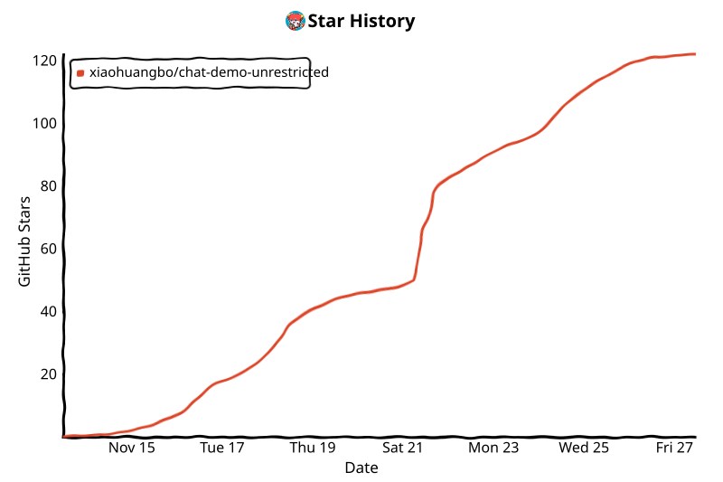

<p align="center">
  
</p>

<h1 align="center">deepseek unrestricted chat harness</h1>

<p align="center">
  deepseek unrestricted chat harness —— 基于 DeepSeek API 的静态聊天前端，带解除限制模式、回复改写与参数直调<br>
  <a href="./README.md">English</a> | 简体中文
</p>

> 本项目是官方示例 [deepseek-ai/chat-demo](https://github.com/deepseek-ai/chat-demo) 的**非官方修改版**（fork），MIT 许可。
> 所有改动都在浏览器里完成：请求体怎么拼、回复怎么存、界面怎么显示。没有代理、没有中转服务，
> API Key 与对话记录仍只保存在你自己的浏览器里。
>
> 🔗在线版：<https://chat-unrestricted.fur0.com/>
>
> 📦仓库：<https://github.com/xiaohuangbo/chat-demo-unrestricted>
>
> 🎥介绍视频：<https://www.bilibili.com/video/BV1m3s66WESg/>
>
> 📚参考论文：<https://arxiv.org/pdf/2403.12171>

<p align="center">
  
</p>

---

## 本仓库新增了什么

- **解除限制与提示词工程**：越狱模式、系统提示词预设、每轮注入、中文越狱提示词、自定义思维链；
- **浏览器 Agent 工具**（默认关闭，逐项开关）：时间、定位、天气、通知、剪贴板、抓网页、生成文件、打开链接、可视化组件；
- **虚拟工作区**：浏览器本地文件库，任意格式导入导出、OPFS 真文件系统、安卓端为应用存储；
- **NanoVM Slim**：内置 WASM Shell Engine 与 130 个 busybox 命令，桌面端右侧停靠、手机端底部面板，Python / Node / Lua / SQLite / esbuild / tsc / Sass / Terser / Prettier / make / Git 按需安装，虚拟机内自带虚拟网络（Node 与 Python 的 HTTP / WebSocket 服务）；
- **WebVM（CheerpX）**：第二个终端跑真正的 x86 Debian 10，自带 bash / gcc / g++ / Python 3 / Node.js / Ruby / Lua / make / git / vim；与 NanoVM 同时运行、自由切换，支持导入导出与模型调用，磁盘改动写进 IndexedDB 覆盖层；
- **聊天模式**：仅聊天 / 网页 Agent / PTC / 创造，决定下发哪些客户端工具与往返上限；
- **关键词拒答**：设置 → 模型里配置关键词、大小写与自定义话术，命中用户输入时本地直接拒答，不请求接口，未填 API Key 也能触发；
- **统计与计费**：用量账本、上下文分类、按模型计费、服务端搜索免费开关；
- **安卓端**：APK 构建、应用内更新检测、NanoVM 联网内置代理；WebVM 因 Android WebView 不支持跨源隔离而只能在浏览器里运行。

## 文档导航

README 已经拆成 `docs/zh/` 下的分册，首页只保留简介与入口；英文文档在 [`docs/en/`](docs/en/README.md)。

| 章节                  | 内容                                                    | 文件                                                   |
| --------------------- | ------------------------------------------------------- | ------------------------------------------------------ |
| 1. 这是什么           | 项目定位、原版功能与本仓库新增的能力清单                | [01-what-is-this.md](docs/zh/01-what-is-this.md)       |
| 2. 原版做了哪些限制   | 请求侧与界面侧被写死的地方                              | [02-original-limits.md](docs/zh/02-original-limits.md) |
| 3. 本仓库做了哪些改动 | 3.1–3.30：设置页每一组功能、NanoVM Slim、WebVM、聊天模式的细节 | [03-changes.md](docs/zh/03-changes.md)                 |
| 4. 行为对照表         | 原版 / 默认 / 越狱模式逐项对比                          | [04-behaviour.md](docs/zh/04-behaviour.md)             |
| 5. 设置项速查         | 每一项的默认值与 localStorage 键名                      | [05-settings.md](docs/zh/05-settings.md)               |
| 6. 请求体实际内容     | 实际发出去的 JSON 长什么样                              | [06-request.md](docs/zh/06-request.md)                 |
| 7. 实现位置索引       | 每个能力对应的源码文件                                  | [07-implementation.md](docs/zh/07-implementation.md)   |
| 8. 数据、隐私与网络   | 数据都存在哪、请求发往哪里                              | [08-privacy.md](docs/zh/08-privacy.md)                 |
| 9. 运行与构建         | 开发、构建与 Android APK 打包                           | [09-build.md](docs/zh/09-build.md)                     |
| 10. 已知限制          | 66 条边界与取舍                                         | [10-known-limits.md](docs/zh/10-known-limits.md)       |
| 11. 许可与致谢        | MIT 许可与上游                                          | [11-license.md](docs/zh/11-license.md)                 |

## 快速开始

```sh
pnpm install
pnpm dev                       # 本地开发（http://localhost:8090）
pnpm build                     # 构建静态产物到 dist/
KS_PASS=<keystore密码> ./构建APK.sh   # 构建并签名 Android APK
```

完整说明（环境变量、签名、字体与离线细节）见 [9. 运行与构建](docs/zh/09-build.md)。

预构建产物：`deepseek-unrestricted-2.7.3.apk`（7.5 MB，versionCode 273，
SHA-256 `77d8ccbe13c44d8371703664589dff072813c411064315939403f2bda63a02de`），详情见 [android/README.md](android/README.md)。

## 兼容性

最近一次兼容性回归（2026-11，v2.7.3，`compat` / `compat-prod` 两套矩阵）：

| 范围            | 覆盖                                                       | 结果  |
| --------------- | ---------------------------------------------------------- | ----- |
| 浏览器          | Chromium、Firefox                                          | 13/13 |
| 视口            | 320 / 390 / 768 / 1024 / 1440 / 1920                       | 13/13 |
| 主题与语言      | 明 / 暗、zh-CN / en-US                                     | 13/13 |
| 生产静态构建    | `dist/` 产物跑同一套用例                                   | 13/13 |
| NanoVM / 工具链 | 终端、配额、工具调用、11 条工具链、虚拟网络                | 21/21 |
| WebVM / CheerpX | 跨源隔离、启动、xterm 输入、滚动、导入导出、切换、Agent 工具 | 通过  |
| 关键词拒答      | 开关、大小写、无 Key 本地回复、不请求接口                   | 通过  |
| 聊天模式        | 仅聊天 / 网页 Agent / PTC / 创造 的工具分组与往返上限      | 10/10 |
| 移动端布局      | 320 / 360 / 390 / 414 / 599 / 767 与桌面 768 / 1024 / 1440 | 49/49 |
| 安卓 APK        | Android 14 WebView（320dp）：启动、终端、虚拟网络、控制台；WebVM 受 WebView 跨源隔离限制 | 通过  |

浏览器与桌面/移动端的边界、已知取舍见 [10. 已知限制](docs/zh/10-known-limits.md)。

## 最近版本

- **2.7.3**：修复手机端 NanoVM 面板被标签条撑高、WebVM 终端无法滚动的问题；设置 → 模型新增关键词拒答（本地匹配、无 Key 可用、不请求接口）；已知限制补到 66 条。
- **2.7.2**：新增 WebVM / CheerpX 终端：浏览器里的 x86 Debian 10，自带 gcc / g++ / Python 3 / Node.js / Ruby / Lua / make / git / vim；与 NanoVM 同时运行、自由切换，支持导入导出、编程环境检测与 `webvm_shell` / `webvm_ls` / `webvm_status` 三个模型工具。
- **2.7.1**：虚拟机虚拟网络（`vm serve` + `serve` + `wscat`，curl 访问 127.0.0.1 自动路由）；Node 补齐 `http`/`ws`，Python 支持 `pip install` 与 Flask/WSGI；新增 tsc / Sass / Terser / Prettier 工具链与 12 条开发命令。
- **2.7.0**：手机端输入栏把思维链 / 智能搜索 / 深度思考挪到第二排并显示文字标签（桌面不变）；NanoVM Slim 新增 26 条命令与 jq 子集；设置里新增 Lua / SQLite / esbuild / make 按需工具链。
- **2.6.9**：设置 → 关于新增「检查更新」（安卓端直接给 APK 链接）；修复终端光标残影；安卓端工作区改为应用存储语义并放宽配额；README 拆分为分册。
- **2.6.8**：NanoVM Slim（WASM shell + busybox + 按需工具链）、聊天模式四档、虚拟机联网（APK 内置反向代理）、切换输入法与红色重置。
- 更早的版本见应用内 **设置 → 更新日志**。

## Star 历史

<!-- star-history:start -->
<picture>
  <source media="(prefers-color-scheme: dark)" srcset="assets/star-history/star-history-dark.svg" />
  <source media="(prefers-color-scheme: light)" srcset="assets/star-history/star-history-light.svg" />
  
</picture>
<!-- star-history:end -->

## 许可

MIT，见 [11. 许可与致谢](docs/zh/11-license.md)。
